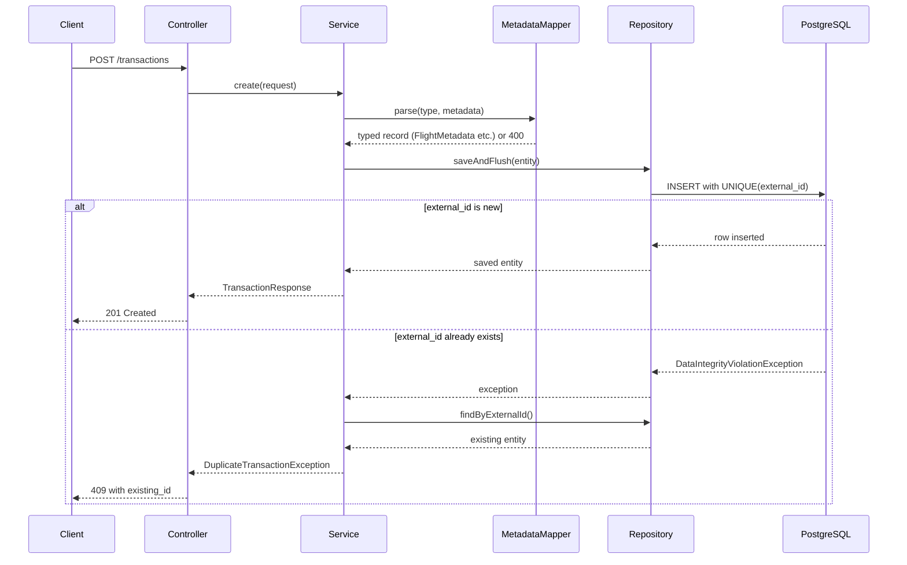
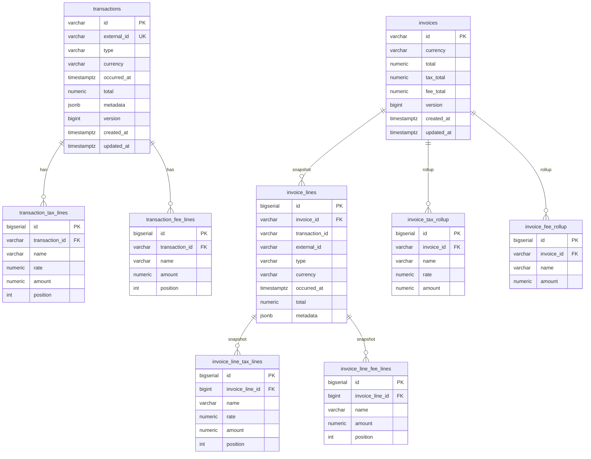

# Architecture

## Overview

This service stores travel commerce transactions (flight, hotel, rail, Navan fee) and produces frozen invoice snapshots. The two hardest requirements — duplicate rejection under concurrency and an invoice that never changes after creation — are both solved at the database level, not in application code.

---

## Request flow



---

## Data model



---

## Package structure

```
com.faiq.navanbillingservice
├── common/                     ← IdGenerator, GlobalExceptionHandler
├── transaction/
│   ├── api/                    ← TransactionController, DTOs (request/response)
│   ├── application/            ← TransactionService, MetadataMapper, TransactionMapper
│   ├── domain/                 ← TransactionType, NavanFeeKind enums
│   │   └── metadata/           ← FlightMetadata, HotelMetadata, RailMetadata, NavanFeeMetadata
│   └── persistence/            ← JPA entities, Spring Data repositories
└── invoice/
    ├── api/                    ← InvoiceController, DTOs
    ├── application/            ← InvoiceService, InvoiceMapper, RollupCalculator
    └── persistence/            ← JPA entities, Spring Data repositories
```

Each feature is self-contained. Adding a new transaction type (`car_rental`) means adding one metadata record and one enum value — no existing code changes.

---

## Key design decisions

### 1. external_id uniqueness and concurrent POSTs

**Decision:** `UNIQUE` constraint on `transactions.external_id` in the database. No application-level "check then insert".

**Why:** A check-then-insert pattern has a race window. Two concurrent requests can both pass the check and both attempt the insert. The database unique index serialises the conflict — only one writer wins. The service calls `saveAndFlush()` inside `@Transactional`, catches `DataIntegrityViolationException`, then fetches the existing row by `external_id` and returns 409 with the existing id.

```
Thread A:  saveAndFlush() → INSERT → SUCCESS → 201
Thread B:  saveAndFlush() → INSERT → UNIQUE VIOLATION → catch → findByExternalId → 409
```

This is correct and safe under any number of concurrent writers because the database index is the single arbiter.

### 2. Invoice snapshot — frozen by physical copy

**Decision:** When an invoice is created, every field of every included transaction (type, total, tax_lines, fee_lines, metadata) is **copied** into dedicated snapshot tables: `invoice_lines`, `invoice_line_tax_lines`, `invoice_line_fee_lines`. The invoice never joins back to the live `transactions` table.

**Why:** A view or a live join would mean that editing a transaction retroactively changes a billed invoice — which breaks financial integrity. A physical copy means the invoice owns its data. Later edits to a transaction have zero effect on any invoice that already included it. Test 4 proves this by mutating the flight total directly in the database and asserting the invoice still shows 220.00.

**Bonus:** `invoice_lines.transaction_id` carries a `REFERENCES transactions(id)` with default `RESTRICT`. This means Postgres itself will block deletion of a transaction that is still referenced by any invoice line, independent of the application-level 409 check.

### 3. Taxes vs fees — always separate

**Decision:** `transaction_tax_lines` (VAT, airport tax — with optional `rate`) and `transaction_fee_lines` (YQ surcharge, booking fee) are separate child tables. Never merged into a single column.

**Why:** The brief is explicit: "do not mash fees into tax_lines." More importantly, taxes and fees have different semantics for accounting, reporting, and rollup. The invoice rollup groups taxes by `(name, rate)` and fees by `name` separately, producing distinct `invoice_tax_rollup` and `invoice_fee_rollup` rows. A merged column would make this grouping ambiguous.

### 4. Type-specific metadata — JSONB with typed Java validation

**Decision:** Type-specific fields (flight coupons, hotel address, rail legs, navan_fee kind) live in a `JSONB metadata` column. However, every incoming request is parsed and validated through a typed Java record before persistence.

**Why:** A normalized approach (separate `flight_details`, `hotel_details` tables) would require a migration for every new type. JSONB avoids that. But raw JSONB with no validation would allow storing a flight as a hotel blob — which the brief explicitly forbids. The `MetadataMapper` parses the incoming JSON into the correct typed record (`FlightMetadata`, `HotelMetadata`, etc.) using Jackson, validates it with `@NotNull`/`@Valid` annotations, and rejects unknown types with 400 before any database write occurs.

**Type routing:**

| type | metadata record | key fields |
|---|---|---|
| flight | FlightMetadata | origin, destination, fare, coupons[] (flight_number, from, to, departure, arrival) |
| hotel | HotelMetadata | name, address (street, city, country), check_in, check_out, nights, room_rate_per_night |
| rail | RailMetadata | legs[] (origin, destination, departure, arrival, train_number, class) |
| navan_fee | NavanFeeMetadata | fee_kind (trip_fee \| agent_call_fee), description, related_external_id |

### 5. Money precision

**Decision:** `NUMERIC(19,4)` in PostgreSQL, `java.math.BigDecimal` in Java.

**Why:** IEEE 754 `double` cannot represent 0.1 exactly, which means `0.1 + 0.2 != 0.3` in floating-point arithmetic. For financial totals this is unacceptable. `BigDecimal` with a fixed scale of 4 gives exact decimal arithmetic. All rollup totals use `BigDecimal::add` with `reduce(BigDecimal.ZERO, BigDecimal::add)`.

### 6. Row locking for PATCH and DELETE

**Decision:** PATCH and DELETE on transactions and invoices acquire a `SELECT ... FOR UPDATE` row lock before any mutation.

**Why:** Without a lock, a concurrent invoice creation and a PATCH on the same transaction could interleave: the invoice snapshots the old value, the PATCH updates it, and the snapshot captures a partial state. The row lock serialises these operations: the invoice builder holds a share lock on each transaction it reads, and the PATCH must wait for an exclusive lock before proceeding.

---

## High volume

### What was done

| Concern | Solution |
|---|---|
| Duplicate POST races | `UNIQUE INDEX` on `external_id` — serialised by the index, not by application locks |
| Fast single-row lookup | Primary key indexes on `transactions.id` and `invoices.id` |
| "Is this transaction invoiced?" | `INDEX (transaction_id)` on `invoice_lines` — single index lookup, not a table scan |
| List query performance | `INDEX (created_at, id)` on both main tables for keyset pagination |
| No unbounded queries | All list endpoints enforce `LIMIT` via Spring Data `Pageable`. `limit > 100` returns 400 |
| Write throughput | Hibernate batch inserts (`batch_size: 25`) — reduces DB round-trips for child rows |
| Connection efficiency | HikariCP pool (max 10 connections, min 2 idle) |

### What breaks first under load and why

**1. High duplicate POST volume:** The `saveAndFlush` + catch + `findByExternalId` pattern adds a second query on every conflict. Under extreme write load many threads will race, most will conflict, and each conflict costs two DB round-trips. The fix is a native `INSERT ... ON CONFLICT (external_id) DO NOTHING RETURNING id` which eliminates the second query entirely.

**2. PATCH-heavy workloads on the same row:** `SELECT ... FOR UPDATE` causes writers to queue behind each other on the same transaction row. For billing this is acceptable (PATCH frequency is low). Under very high PATCH volume the fix is a message queue in front of writes for the same entity.

**3. Large table list queries:** Even with keyset pagination the index scan reads sequentially. At very high table sizes (hundreds of millions of rows) the fix is table partitioning by `created_at` month, so each scan touches only one partition.

**4. Hot JSONB metadata fields:** Querying inside JSONB (e.g. "all flights to LHR") requires a full table scan unless you add a `JSONB` expression index like `CREATE INDEX ON transactions ((metadata->>'destination'))`. The current schema does not need this for the required endpoints but would need it for analytics queries.

**What is NOT needed:** Redis, Kafka, Prometheus, distributed lock managers, or nginx. The database unique constraint, row locks, and indexes solve the concurrency and volume requirements within the single-node scope of this service.